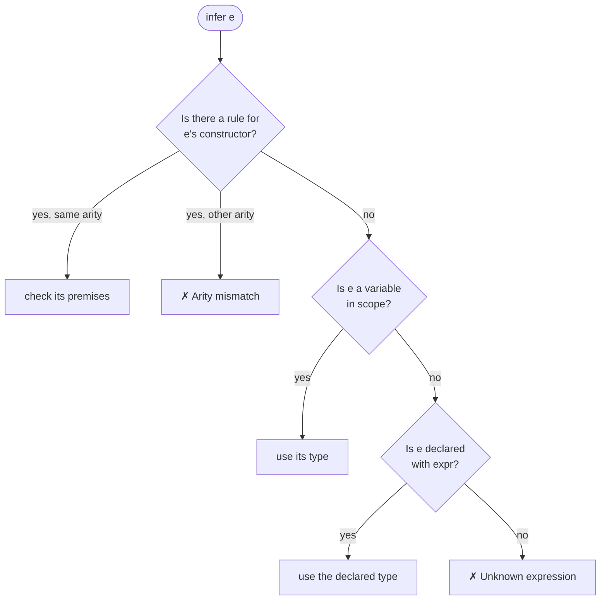
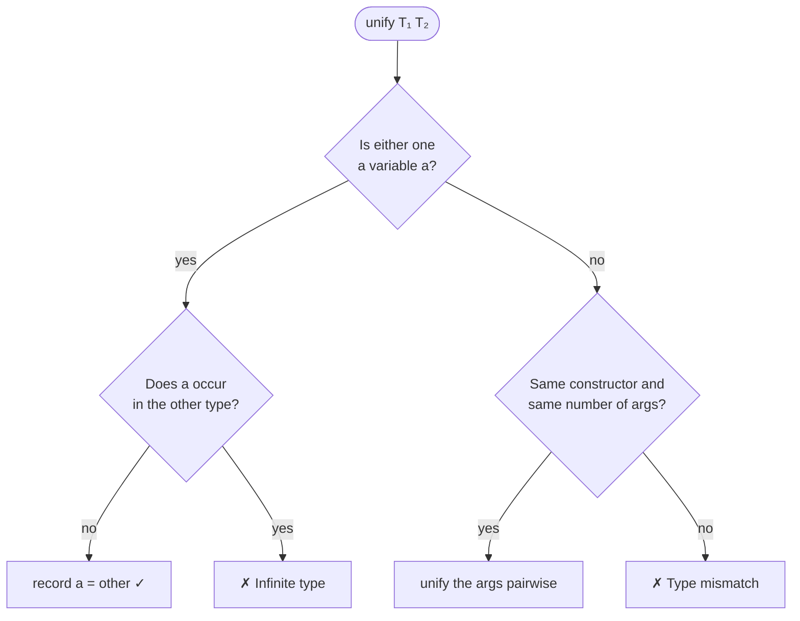

# PAL Tutorial

Learn how type systems work by building some in PAL. Each section adds one idea and traces what the typechecker does with it.

1. [Judgments and rules](#1-judgments-and-rules)
2. [Your first type system](#2-your-first-type-system)
3. [Type variables](#3-type-variables)
4. [Unification](#4-unification)
5. [Polymorphic constants](#5-polymorphic-constants)
6. [Variables and binders](#6-variables-and-binders)
7. [Let-polymorphism](#7-let-polymorphism)
8. [More type systems](#8-more-type-systems)
9. [Dependent types](#9-dependent-types)
10. [Bidirectional typing](#10-bidirectional-typing)
11. [Testing your type system](#11-testing-your-type-system)
12. [Exercises](#12-exercises)

To follow along, open a REPL with `nix develop` and then `pal`, or run `pal-ui` for a browser editor that checks as you type. The [README](README.md) has the full syntax reference.

---

## 1. Judgments and rules

A type system decides which programs make sense, without running them. It is built from two things.

**Judgments** are statements of the form *expression `:` type*:

```
True : Bool
Add(One, One) : Num
```

**Inference rules** say: *if the premises above the line hold, the conclusion below holds*.

```
  x : Num    y : Num              rule Add:
 ──────────────────── Add           x : Num
   Add(x, y) : Num                  y : Num
                                  ->
                                    Add(x, y) : Num
```

In a rule, `x` and `y` are placeholders that stand for *any* expression. A rule with no premises is an **axiom**. In PAL, you write axioms with `expr`:

```
 ───────────── expr               expr True : Bool
  True : Bool
```

To typecheck an expression, PAL stacks rules into a **derivation tree**, with the expression at the root and axioms at the leaves. If such a tree exists, the expression is well-typed. If not, PAL reports which premise failed. In the REPL, `:derive e` draws the tree PAL built for `e`. `pal --derivations` and the web UI show them too.

---

## 2. Your first type system

```haskell
type Bool
type Num
expr True   : Bool
expr False  : Bool
expr LitInt : Num

rule Not:              rule And:
  x : Bool               x : Bool
->                       y : Bool
  Not(x) : Bool        ->
                         And(x, y) : Bool
```

Every type must be declared with `type` before it is used. A typo such as `expr T : Bol` is rejected, with a hint: *undeclared type Bol (did you mean Bool?)*.

### How `infer And(True, Not(False))` works

1. **Pick a rule.** PAL finds the rule whose conclusion has the same constructor (`And`) and the same number of arguments (2).
2. **Match.** It lines the conclusion up with the expression: `x ↦ True`, `y ↦ Not(False)`.
3. **Check each premise** by inferring the matched expression's type, recursively:
   - `True : Bool`? `True` is declared `Bool`. ✓
   - `Not(False) : Bool`? This applies the `Not` rule, and `False` is declared `Bool`. ✓
4. **Return the conclusion's type:** `Bool`.

That builds this derivation, as `:derive And(True, Not(False))` draws it:

```
                      ────────────── expr
                       False : Bool
───────────── expr    ─────────────────── Not
 True : Bool           Not(False) : Bool
───────────────────────────────────────────── And
        And(True, Not(False)) : Bool
```

### When it fails

```
✗ Not(True, False) -> Arity mismatch: expected 1 arg(s), got 2
✗ And(True, LitInt) -> Type mismatch: expected Bool, got Num
```

The first has no `Not` rule with two arguments. The second matches, but the premise `y : Bool` doesn't hold, because `LitInt` is a `Num`.

PAL points at the culprit and says which premise it was checking:

```
pal❯ And(True, LitInt)
✗ And(True, LitInt) -> [Error] Type mismatch: expected Bool, got Num
    at input:1:11
      |
    1 | And(True, LitInt)
      |           ^^^^^^
    in rule And, premise y : Bool  (checking LitInt)
```

### The search, in full



---

## 3. Type variables

A lowercase type name is a **type variable**. It lets one rule work at many types:

```haskell
rule If:
  c : Bool
  t : a
  e : a
->
  If(c, t, e) : a
```

Because the same `a` appears three times, this rule says that both branches have the same type, and the `If` has that type too.

### How `infer If(True, One, Zero)` works

Each use of a rule gets **fresh** variables, so `a` becomes `a₁`. PAL then checks the premises in order and records what it learns in a **substitution**:

| Premise    | Inferred | Learned        |
| ---------- | -------- | -------------- |
| `c : Bool` | `Bool`   | —              |
| `t : a₁`   | `Num`    | `a₁ = Num`     |
| `e : a₁`   | `Num`    | matches ✓      |

The result is `a₁`, which is `Num`.

### Why `If(True, One, False)` fails

| Premise    | Inferred | Learned                                      |
| ---------- | -------- | -------------------------------------------- |
| `t : a₁`   | `Num`    | `a₁ = Num`                                   |
| `e : a₁`   | `Bool`   | ✗ **expected Num, got Bool**                 |

Once the first branch fixes `a₁`, the second branch has to agree.

---

## 4. Unification

"Learning" `a₁ = Num` is called **unification**: finding values for type variables that make two types equal. PAL compares the two types structurally:



| Unify                          | Result                      |
| ------------------------------ | --------------------------- |
| `Num` with `Num`               | ✓                           |
| `Num` with `Bool`              | ✗ mismatch                  |
| `a` with `Num`                 | ✓ `a = Num`                 |
| `Pair<a, Bool>` with `Pair<Num, b>` | ✓ `a = Num`, `b = Bool` |
| `a` with `Arrow<a, b>`         | ✗ infinite type             |

The last row is the **occurs check**. `a = Arrow<a, b>` would make `a` infinitely large, so PAL rejects it.

Variables that are never solved are printed as `a`, `b`, … in the result. For example, `Lam(x, x) :: Arrow<a, a>`.

---

## 5. Polymorphic constants

Types can take parameters, such as `Maybe<Num>` or `Pair<Num, Bool>`. Declare them with their parameters, `type Maybe<a>`, and PAL checks that every use has the right number. A declared constant can mention type variables too:

```haskell
expr Nothing : Maybe<a>

rule Just:              rule FromMaybe:
  x : a                   d : a
->                        m : Maybe<a>
  Just(x) : Maybe<a>    ->
                          FromMaybe(d, m) : a
```

Every *use* of `Nothing` gets its own fresh `a`. This is called **instantiation**. So `Nothing` can be a `Maybe<Bool>` in one place and a `Maybe<Num>` in another.

### How `infer FromMaybe(True, Nothing)` works

| Premise         | Inferred                 | Learned                                         |
| --------------- | ------------------------ | ----------------------------------------------- |
| `d : a₁`        | `Bool`                   | `a₁ = Bool`                                     |
| `m : Maybe<a₁>` | `Maybe<a₂>` (fresh copy) | `Maybe<Bool>` with `Maybe<a₂>`, so `a₂ = Bool` ✓ |

The result is `Bool`. By contrast, `FromMaybe(LitInt, Just(True))` fails, because the default is a `Num` but the contents are a `Bool`.

---

## 6. Variables and binders

To type `λx. body`, you first need to know what `x` is. A **typing context** Γ holds those assumptions, for example `{ x : a }`. A premise can add to Γ with `|-`:

```haskell
rule Lam:                           rule App:
  x : a |- body : b                   f : Arrow<a, b>
->                                    x : a
  Lam(x, body) : Arrow<a, b>        ->
                                      App(f, x) : b
```

Read the `Lam` premise as: *assuming `x : a`, the body has type `b`*. The assumption only applies while the body is checked.

### How `infer Lam(x, x)` works

1. Get fresh variables `a₁`, `b₁`, then match: `body ↦ x`.
2. Check the body with Γ = `{ x : a₁ }`. The body is `x`, which Γ says has type `a₁`, so `b₁ = a₁`.
3. Result: `Arrow<a₁, a₁>`, printed as **`Arrow<a, a>`**: a function from any type to the same type.

### How `infer App(Lam(x, x), True)` works

Types flow *into* the lambda from its argument:

| Step                              | Learned                    |
| --------------------------------- | -------------------------- |
| `App`, fresh: `f : Arrow<a₁, b₁>`, `x : a₁` | —                |
| `f` is `Lam(x, x)` : `Arrow<a₂, a₂>` | `a₁ = a₂`, `b₁ = a₂`    |
| `x` is `True` : `Bool`            | `a₂ = Bool`                |
| Result `b₁`                       | **`Bool`**                 |

### Three things to try

```
✓ Lam(x, App(Not, x)) :: Arrow<Bool, Bool>    -- x's type is inferred from how it is used
✓ Lam(x, Lam(x, x))   :: Arrow<a, Arrow<b, b>> -- the inner x shadows the outer one
✗ Lam(x, App(x, x))   -> Infinite type: a ~ Arrow<a, b>
```

The last one is self-application. `x` would need to be a function that takes itself as an argument, and the occurs check from §4 rejects that.

---

## 7. Let-polymorphism

A variable bound with `|-` has **one** type. That's right for a lambda's parameter, but too strict for `let`:

```haskell
rule MonoLet:
  value : a
  x : a |- body : b
->
  MonoLet(x, value, body) : b
```

```
✗ MonoLet(id, Lam(x, x), Pair(App(id, True), App(id, LitInt)))
  -> Type mismatch: expected Bool, got Num
```

The first use fixes `id : Arrow<Bool, Bool>`, so the second use fails. Marking the hypothesis **`gen`** makes `x` polymorphic, so each use gets fresh variables, just like the constants in §5:

```haskell
rule Let:
  value : a
  x : gen a |- body : b
->
  Let(x, value, body) : b
```

```
✓ Let(id, Lam(x, x), Pair(App(id, True), App(id, LitInt))) :: Pair<Bool, Num>
```

Two details:

- **Order matters.** `value : a` must come before the `gen` premise, so that `a` is already known.
- **Only "new" variables are generalised.** Type variables that also appear in Γ belong to an enclosing binder, so they stay fixed. That's why lambdas must *not* use `gen`.

[`hm.pal`](examples/programs/hm.pal) shows `Let` and `MonoLet` side by side.

---

## 8. More type systems

The files in [`examples/programs/`](examples/programs/) combine the ideas above into complete, classic type systems. Open any one with `pal -i examples/programs/NAME.pal`. Each file states its expected results with `check e : T` and `fails e`, so running it is also a test.

| File           | System                          | What's new                                  |
| -------------- | ------------------------------- | ------------------------------------------- |
| `arith.pal`    | Typed arithmetic (TAPL ch. 8)   | Nothing. A good first read                  |
| `stlc.pal`     | Simply typed λ-calculus         | §6 in full, plus `Let`                      |
| `stlc-ext.pal` | Products, sums, `Fix`           | `Case`: two binders in one rule             |
| `lists.pal`    | Polymorphic lists               | `Fold`: a rule that takes a function        |
| `hm.pal`       | Hindley–Milner                  | `gen` (§7)                                  |
| `logic.pal`    | Propositional logic             | Types as propositions                       |
| `lambda-pi.pal` | Dependent types (λΠ)           | Types that mention expressions (§9)         |
| `subtyping.pal` | Subtyping                      | A relation `a <: b` beside `e : T`          |
| `linear.pal`   | Linear and affine types         | `lin`, `aff` and `share`                    |

**Sums.** `Case` checks each branch with its own variable in scope:

```haskell
rule Case:
  s : Sum<a, b>
  x : a |- left : c
  y : b |- right : c
->
  Case(s, x, left, y, right) : c
```

**Logic.** Read `Implies<A, B>` as A → B, `And` as ∧ and `Or` as ∨. The rules then become the rules of logic, so the type PAL infers for a term is the theorem that the term proves (the Curry–Howard correspondence):

```
✓ Lam(p, Pair(Snd(p), Fst(p))) :: Implies<And<a, b>, And<b, a>>     -- ∧ commutes
✓ Lam(f, Absurd(f))            :: Implies<False, a>                -- ex falso
✗ Lam(p, App(p, p))            -> Infinite type                    -- proves nothing
```

**Data types.** Writing the rules of a data type by hand is long. A `data` declaration writes them for you:

```haskell
data Nat = Zero | Succ(Nat)
```

This gives the type `Nat`, the constructors `Zero` and `Succ`, and a recursor `RecNat(n, zero, succ_1, succ_rec1, succ)`. In the branch `succ`, `succ_1` is the predecessor and `succ_rec1` is the result for it, so `RecNat(n, Zero, m, r, Succ(Succ(r)))` doubles `n`. Reductions such as `RecNat(Zero, …) ~> zero` make it compute.

**Linear types.** In a linear type system, a value is a resource: it must be used exactly once. Mark the hypothesis `lin` (or `aff` for at most once):

```haskell
rule Lam:
  x : lin a |- body : b
->
  Lam(x, body) : Lolli<a, b>
```

Now `Lam(x, x)` is fine, but `Lam(x, Pair(x, x))` and `Lam(x, True)` are usage errors. The premises of a rule split the resources, so their uses add up. For the two branches of an `If`, mark the premises `share`: each branch may use the same resources. See [`linear.pal`](examples/programs/linear.pal).

**Subtyping.** Some systems need judgments of other forms than `e : T`. A rule whose conclusion is, for example, `a <: b` defines a *relation*, and other rules can use it as a premise:

```haskell
rule SubArrow:                       rule App:
  a2 <: a1                             f : Arrow<a, b>
  b1 <: b2                             x : c
->                                     c <: a
  Arrow<a1, b1> <: Arrow<a2, b2>     ->
                                       App(f, x) : b
```

PAL proves `c <: a` by searching backwards through the rules for `<:`. `holds Arrow<Int, Nat> <: Arrow<Nat, Int>` checks a judgment directly. See [`subtyping.pal`](examples/programs/subtyping.pal).

**Proof search.** You can also ask PAL for the proof. `find T` searches backwards from `T` through the rules, and shows the smallest term of that type that it finds:

```
✓ find Implies<Or<a, b>, Or<b, a>> — Lam(x, Case(x, y, Inr(y), z, Inl(z)))
✗ find Or<a, Implies<a, False>>   — no term of this type found
```

The second line is the law of excluded middle. It is not a theorem of this logic (intuitionistic logic), so no search can find a proof. But when the search finds nothing, that alone does not show that no proof exists: the search stops after 6 rules (write `find T 10` to go deeper).

---

## 9. Dependent types

Up to now, a type only mentions other types. A **dependent type** can also mention an expression: `Vec(n, a)` is the type of vectors that contain `n` values of type `a`. Then the type checker can find a wrong length before the program runs.

In PAL, expressions and types are the same terms, so you need only three new ideas. [`lambda-pi.pal`](examples/programs/lambda-pi.pal) has all of them.

### Types that mention expressions

Types are now terms, so declare them with `expr` and check them with rules. `Type` is the type of types:

```haskell
expr Type : Type
expr Nat  : Type
expr Zero : Nat

rule Succ:              rule Vec:                  rule Replicate:
  n : Nat                 n : Nat                    n : Nat
->                        a : Type                   x : a
  Succ(n) : Nat         ->                         ->
                          Vec(n, a) : Type           Replicate(n, x) : Vec(n, a)
```

In a rule, a variable of the conclusion stands for the matched expression, also in the types. In `infer Replicate(Succ(Zero), Zero)`, `n` is `Succ(Zero)`, so the type is `Vec(Succ(Zero), Nat)`. The other lowercase variables, like `a`, are type variables as before.

### Π-types

The type of a function can depend on its argument. `Pi(x, t, u)` is the type of functions that take an `x` of type `t` and give a `u`, where `u` can mention `x`:

```haskell
rule Pi:                  rule Lam:                       rule App:
  t : Type                  t : Type                        f : Pi(x, t, u)
  x : t |- u : Type         x : t |- body : u               a : t
->                        ->                              ->
  Pi(x, t, u) : Type        Lam(x, t, body) : Pi(x, t, u)   App(f, a) : u[x := a]
```

`u[x := a]` is a **substitution**: `u` with `a` in place of `x`. PAL applies it when it knows `u`.

#### How `infer App(Lam(n, Nat, Replicate(n, Zero)), Succ(Zero))` works

| Step                                                            | Learned                                    |
| --------------------------------------------------------------- | ------------------------------------------ |
| `App`, fresh: `f : Pi(x₁, t₁, u₁)`, `a : t₁`                    | —                                          |
| `f` is `Lam(n, Nat, Replicate(n, Zero))` : `Pi(n, Nat, Vec(n, Nat))` | `x₁ = n`, `t₁ = Nat`, `u₁ = Vec(n, Nat)` |
| `a` is `Succ(Zero)` : `Nat`                                     | matches ✓                                  |
| Result `u₁[x₁ := Succ(Zero)]`                                   | **`Vec(Succ(Zero), Nat)`**                 |

PAL gets the **binders** from the rules. The premise `x : t |- u : Type` of the `Pi` rule tells PAL that `x` is bound in `u`. Thus:

- The names of bound variables do not matter: `Pi(m, Nat, Vec(m, Nat))` and `Pi(n, Nat, Vec(n, Nat))` are the same type.
- Substitution does not capture a variable. PAL renames a binder if necessary, for example to `y1`.

A Π over `Type` gives polymorphism:

```
✓ Lam(a, Type, Lam(x, a, x))                   :: Pi(a, Type, Pi(x, a, a))
✓ App(App(Lam(a, Type, Lam(x, a, x)), Nat), Zero) :: Nat
```

### Computation

A type can contain a computation, for example the length of two vectors together:

```haskell
rule Append:                                reduce PlusZero: Plus(Zero, n) ~> n
  xs : Vec(m, a)                            reduce PlusSucc: Plus(Succ(m), n) ~> Succ(Plus(m, n))
  ys : Vec(n, a)
->
  Append(xs, ys) : Vec(Plus(m, n), a)
```

A `reduce` statement says that two terms are equal. When unification finds two different types, PAL reduces both and compares them again. So `Vec(Plus(Succ(Zero), Succ(Zero)), Nat)` fits where `Vec(Succ(Succ(Zero)), Nat)` is expected. Results are shown in normal form:

```
✓ Append(VCons(Zero, VNil), VCons(Zero, VNil)) :: Vec(Succ(Succ(Zero)), Nat)
```

With `reduce Beta: App(Lam(x, t, body), a) ~> body[x := a]`, types can also contain function applications.

`Succ(Succ(Zero))` is long to write. A **definition** gives it a name:

```haskell
def Two  := Succ(Succ(Zero))
def Vec2 := Vec(Two, Nat)
```

PAL infers the type of the body (`Nat`, then `Type`), adds the name as a constant of that type, and adds a reduction from the name to the body. So `Replicate(Two, Zero)` fits where a `Vec2` is expected.

A definition can also have parameters: `def Double(n) := Plus(n, n)`. PAL finds that `n` must be a `Nat`, and adds a rule `n : Nat -> Double(n) : Nat`.

### Limits

- If `u` in `u[x := a]` is still unknown, PAL solves it when `a` is a variable that `u` cannot mention, or else waits until a later premise solves `u`. If no premise does, PAL reports a **stuck substitution**. So give the type of a function before you apply it.
- A variable that appears only in the types of a rule is an unknown, which unification finds: an **implicit argument**. For example, with `IApp(f) : u[a := m]` and `f : Pi(a, Type, u)`, `App(IApp(Id), Zero)` has type `Nat`, and PAL finds `m = Nat`.
- A type cannot mention a variable outside its binder. A `Let` rule with the conclusion `Let(x, value, body) : u` gives a **scope error** when the type of `body` mentions `x`. Write `u[x := value]` instead.
- PAL warns when a reduction may not terminate, or when two reductions are not confluent (a term reduces to two different normal forms). These checks are simple, so a warning is not a proof. A reduction that does not stop gives a **reduction limit** error after 10 000 steps.
- `Type : Type` is inconsistent as a logic, but it is sufficient to experiment.

---

## 10. Bidirectional typing

So far, PAL infers the type of every subterm, then compares it with what the rule expects. Many real type checkers work in two **directions** instead:

- **Synthesis** `e => T`: find the type of `e` from `e` alone.
- **Checking** `e <= T`: the type `T` is known, and `e` must have it.

Some terms can only be checked. An unannotated `Lam(x, x)` has no type of its own, but it checks against `Arrow<Bool, Bool>`. Write the direction in the rules:

```haskell
rule Lam:                        rule App:                  rule Ann:
  x : a |- body <= b               f => Arrow<a, b>           e <= t
->                                 x <= a                   ->
  Lam(x, body) <= Arrow<a, b>    ->                           Ann(e, t) => t
                                   App(f, x) => b
```

A rule with a `<=` conclusion is used only when the expected type is known. PAL first unifies the expected type with the conclusion type, then checks the premises. So in `Lam`, the type `a` of `x` is known before PAL checks the body.

```
✓ check Lam(x, x) : Arrow<Bool, Bool>
✗ infer Lam(x, x)          -> Cannot infer the type of Lam(x, x): its rule only checks it against a known type
✓ App(Ann(Lam(x, x), Arrow<Bool, Bool>), True) :: Bool
✗ App(Lam(x, x), True)     -> Cannot infer the type of Lam(x, x)
```

The last line fails because `App` synthesises the type of its function, and a bare lambda cannot synthesise. The annotation `Ann` turns a checked term into a synthesised one. Its argument, in contrast, is checked, so `App(Ann(…), Lam(y, y))` works.

A plain premise `e : T` checks `e` against `T`. For a rule without a direction, checking falls back to inference, so the systems from the earlier sections work as before. [`tests/pass/bidirectional.pal`](tests/pass/bidirectional.pal) has the complete system.

---

## 11. Testing your type system

A type system is **sound** when well-typed programs cannot go wrong. For a system with reductions, two properties together give soundness:

- **Preservation:** if `e : T` and `e` reduces to `e'`, then `e' : T`.
- **Progress:** if `e : T` and `e` is closed, then `e` is a value or `e` can reduce.

A proof takes work. PAL can **test** both properties: it generates many well-typed closed terms from your rules, and it checks each one. Tell PAL which terms are values, then ask for the tests:

```haskell
reduce Beta:    App(Lam(x, body), a) ~> body[x := a]
reduce FstPair: Fst(Pair(a, b)) ~> b       -- a mistake: Fst should give a

value Lam(x, body)
value Pair(a, b)
value True

test preservation
test progress
```

```
✗ test preservation — Lam(x, Fst(Pair(False, x))) : Arrow<a, Bool> reduces to Lam(x, x) : Arrow<a, a>
```

The counterexample shows the mistake: `Fst(Pair(False, x))` has the type of `False`, but it reduces to `x`. Correct the reduction to `~> a` and the test passes.

Progress finds a missing reduction. With a rule for `Not` but no `reduce` for it, PAL reports that `Not(False)` is stuck: it does not reduce, and it is not a value.

PAL reports the smallest counterexample that it found. A test that passes is good evidence, but it is not a proof: PAL checks only the terms that it generated. Give a larger number, such as `test preservation 20000`, to check more terms.

---

## 12. Exercises

Start with `pal -i examples/programs/stlc.pal`, then add rules as you go. Write each answer as a `check` (or `fails`) and PAL will tell you whether you are right.

1. Add `rule Eq: x : a, y : a -> Eq(x, y) : Bool`. What do `Eq(LitInt, LitInt)` and `Eq(LitInt, True)` give?
2. Declare `type List<a>`, add `expr Nil : List<a>` and a `Cons` rule. Type `Cons(True, Cons(True, Nil))`.
3. Predict the type of `Lam(f, Lam(x, App(f, x)))` before you run it.
4. Why is `App(Lam(x, x), Lam(y, y))` typed `Arrow<a, a>`?
5. Write a `Compose(f, g)` rule, then try `Compose(Not, IsZero)`.
6. In `lambda-pi.pal`, write a `Head(xs)` rule that accepts only a vector that is not empty. Then `Head(VNil)` must fail.

<details>
<summary>Answers</summary>

1. `check Eq(LitInt, LitInt) : Bool` and `fails Eq(LitInt, True)`: the shared `a` forces both arguments to have the same type.
2. `check Cons(True, Cons(True, Nil)) : List<Bool>`, using:
   ```haskell
   rule Cons:
     x  : a
     xs : List<a>
   ->
     Cons(x, xs) : List<a>
   ```
3. `check Lam(f, Lam(x, App(f, x))) : Arrow<Arrow<a, b>, Arrow<a, b>>`.
4. `check App(Lam(x, x), Lam(y, y)) : Arrow<a, a>`. The argument is the identity function, so the result is the identity function's type.
5. `check Compose(Not, IsZero) : Arrow<Num, Bool>`, using:
   ```haskell
   rule Compose:
     f : Arrow<b, c>
     g : Arrow<a, b>
   ->
     Compose(f, g) : Arrow<a, c>
   ```
6. `check Head(VCons(Zero, VNil)) : Nat` and `fails Head(VNil)`, using:
   ```haskell
   rule Head:
     xs : Vec(Succ(n), a)
   ->
     Head(xs) : a
   ```

</details>
